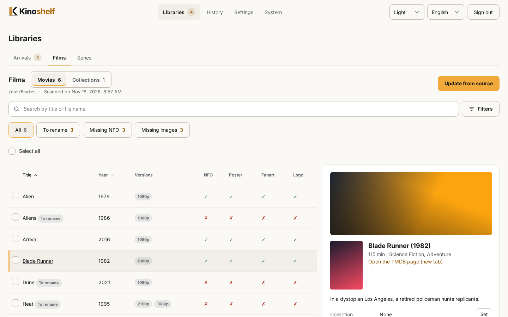

<h1 align="center">
  <picture>
    <source media="(prefers-color-scheme: dark)" srcset="packages/web/src/assets/kinoshelf-logo.svg">
    
  </picture>
</h1>

<p align="center">
  <a href="https://github.com/DjLeChuck/kinoshelf/actions/workflows/ci.yml">
    
  </a>
</p>

Kinoshelf identifies video files (movies, series) **already on disk**, renames them to match your
player's conventions (Plex, Jellyfin) and writes their metadata (NFO, artwork). It is a web-native
equivalent of tinyMediaManager and a companion to Radarr/Sonarr: it never downloads anything.

> **Status: work in progress, no stable release yet.** The core, the CLI, the REST server, the
> Docker image and the web UI (libraries, arrivals, history, settings) all work, as do the folder
> watcher and the NFO and artwork writers for Plex and Jellyfin.

<p align="center">
  <picture>
    <source media="(prefers-color-scheme: dark)" srcset="docs/images/libraries.png">
    
  </picture>
</p>

## Features

**Identify and organize**

- **Libraries** organized in place, and **arrival folders** whose files are identified then copied,
  hardlinked or moved into them. Movies and series can live in separate libraries.
- A matcher built on [guessit](https://github.com/opensubtitles/guessit-js) and TMDB, tuned on a corpus
  of real release names: a score and a threshold decide, and anything uncertain waits for you. A
  series is validated as a **release**, not file by file.
- **Arrivals**: the files Kinoshelf could not place with confidence wait here, with their TMDB
  candidates and score. You pick the candidate and the destination library.
- **Several versions** of a movie or an episode (1080p and 2160p) side by side, listed once, with a
  coverage matrix per series.
- **Missing episodes** of a series, counted from TMDB without rescanning.

**Safe by design**

- A preview before every write, the renaming never overwrites an existing file, every batch can be
  undone, no silent copy when a hardlink fails.
- A journal of everything written, with its own **History**.

**Metadata for every player**

- **Naming and metadata options** that suit Plex, Jellyfin and Kodi alike: the TMDB id in the names or
  not, and Kodi-format NFO with artwork or nothing.
- NFO (`movie.nfo`, `tvshow.nfo`, per episode), poster, fanart, clear logo, season posters and
  episode thumbnails, also for a library that is already organized.
- **Artwork you choose**: change the poster, the background, the logo or an episode's thumbnail with one
  of the images TMDB offers or an address of your own (JPEG or PNG). The replaced image is kept and the
  change can be undone.
- **Collections** (sagas): set, rename and choose their images, and send them to Plex and Jellyfin.

**Getting downloads in**

- From your client's "on completion" hook (`kinoshelf submit`) or by watching a folder that only holds
  finished downloads.
- **Notifications**: Plex (sign in with your account) and Jellyfin library refresh, webhooks (generic,
  Gotify, ntfy, Discord).

**Run it and watch it**

- A **System** page: health checks, a live filtered log, TMDB usage, maintenance (tidy a library,
  back up and compact the database, empty what was set aside) and a diagnostic archive for bug
  reports. An **activity panel** shows background tasks everywhere.
- A **REST API** (OpenAPI) and a **command line** (`scan`, `process`, `undo`, `submit`, `tidy`,
  `cleanup`) over the same core.
- French and English, dark and light themes, multi-arch Docker image (`amd64`, `arm64`), or a standalone
  binary for Linux and macOS with no Node to install.

## Quick start

```sh
curl -O https://raw.githubusercontent.com/DjLeChuck/kinoshelf/main/compose.example.yaml
mv compose.example.yaml compose.yaml   # adjust the paths and PUID/PGID
docker compose up -d
```

Without Docker, take the archive of your platform from the releases page and run `./kinoshelf serve`
(see [Installation](docs/0-installation.md#standalone-binary)).

Open `http://<your-server>:8484`: the welcome page asks for your TMDB key (your own, from
[themoviedb.org](https://www.themoviedb.org/settings/api)), creates the API key and walks you
through your first library.

## Documentation

| Page                                                   | What is in it                                                     |
| ------------------------------------------------------ | ----------------------------------------------------------------- |
| [Installation](docs/0-installation.md)                 | Docker, standalone binary, service, permissions, first key, proxy |
| [Concepts and web UI](docs/1-web-ui.md)                | How a file is handled, Welcome, Arrivals, History, Settings       |
| [Libraries](docs/2-libraries.md)                       | Scan, filters, versions, artwork, collections                     |
| [System](docs/3-system.md)                             | Health, logs, TMDB usage, maintenance, diagnostic                 |
| [Getting downloads in](docs/4-getting-downloads-in.md) | Download client hooks, folder watcher                             |
| [Output options](docs/5-output-options.md)             | The `naming` and `metadata` options, Plex, Jellyfin and Kodi      |
| [Configuration](docs/6-configuration.md)               | `config.yaml`, environment variables, notifications               |
| [Command line](docs/7-cli.md)                          | `scan`, `process`, `undo`, `submit`, `tidy`, `cleanup`            |
| [REST API](docs/8-api.md)                              | Authentication, routes, events                                    |
| [Development](docs/9-development.md)                   | Building, testing, documentation, conventions                     |

## License

[MIT](LICENSE). Parsing relies on [guessit-js](https://github.com/opensubtitles/guessit-js)
(LGPL-3.0), used as an unmodified dependency.

This product uses the TMDB API but is not endorsed or certified by TMDB.
