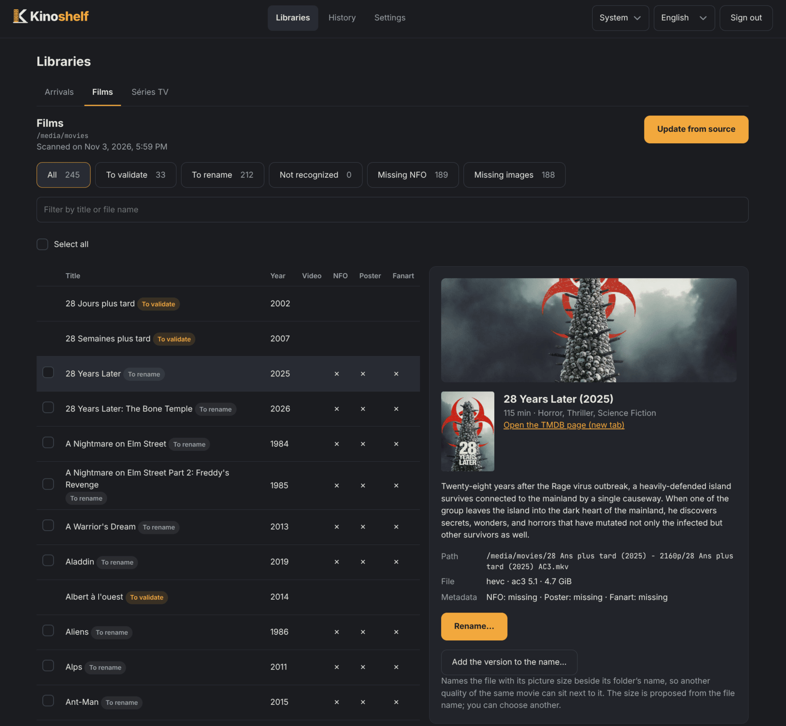

<h1 align="center">
  <picture>
    <source media="(prefers-color-scheme: dark)" srcset="packages/web/src/assets/kinoshelf-logo.svg">
    
  </picture>
</h1>

<p align="center">
  <a href="https://github.com/DjLeChuck/kinoshelf/actions/workflows/ci.yml">
    
  </a>
</p>

Kinoshelf identifies video files (movies, series) **already on disk**, renames them to match your
player's conventions (Plex, Jellyfin) and writes their metadata (NFO, artwork). It is a web-native
equivalent of tinyMediaManager and a companion to Radarr/Sonarr: it never downloads anything.

> **Status: work in progress, no stable release yet.** The core, the CLI, the REST server, the
> Docker image and the web UI (libraries, arrivals, history, settings) all work, as do the folder
> watcher and the NFO and artwork writers for Plex and Jellyfin.

<p align="center">
  
</p>

## Features

- **Libraries** organized in place: filters (to validate, to rename, unrecognized, missing NFO or
  images, missing episodes), a series tree (show, season, episode), a page per item with `ffprobe`.
- **Arrivals**: the files Kinoshelf could not place with confidence wait here, with their TMDB
  candidates and score. You pick the candidate and the destination library.
- **Safe by design**: a preview before every write, no existing file ever overwritten, every batch
  can be undone, no silent copy when a hardlink fails.
- **Profiles** for Plex (`plex`, `plex-no-id`, `plex-nfo`) and Jellyfin, with NFO and artwork.
- **Getting downloads in** from your client's "on completion" hook, or by watching a folder.
- **Notifications**: Plex and Jellyfin library refresh, webhooks (generic, Gotify, ntfy, Discord).
- French and English, dark and light themes, multi-arch Docker image (`amd64`, `arm64`).

## Quick start

```sh
curl -O https://raw.githubusercontent.com/DjLeChuck/kinoshelf/main/compose.example.yaml
mv compose.example.yaml compose.yaml   # adjust the paths and PUID/PGID
docker compose up -d
```

Open `http://<your-server>:8484`: the welcome page asks for your TMDB key (your own, from
[themoviedb.org](https://www.themoviedb.org/settings/api)), creates the API key and walks you
through your first library.

## Documentation

| Page                                                   | What is in it                                          |
| ------------------------------------------------------ | ------------------------------------------------------ |
| [Installation](docs/0-installation.md)                 | Docker, user and permissions, hardlinks, reverse proxy |
| [Concepts and web UI](docs/1-web-ui.md)                | Libraries, Arrivals, History, Settings                 |
| [Getting downloads in](docs/2-getting-downloads-in.md) | Download client hooks, folder watcher                  |
| [Output profiles](docs/3-profiles.md)                  | Plex and Jellyfin naming, NFO and artwork              |
| [Configuration](docs/4-configuration.md)               | `config.yaml`, environment variables, notifications    |
| [Command line](docs/5-cli.md)                          | `kinoshelf scan`, `process`, `undo`, `submit`          |
| [REST API](docs/6-api.md)                              | Authentication, jobs, arrivals, batches                |
| [Development](docs/7-development.md)                   | Building, testing, conventions                         |

## License

[MIT](LICENSE). Parsing relies on [guessit-js](https://github.com/opensubtitles/guessit-js)
(LGPL-3.0), used as an unmodified dependency.

This product uses the TMDB API but is not endorsed or certified by TMDB.
