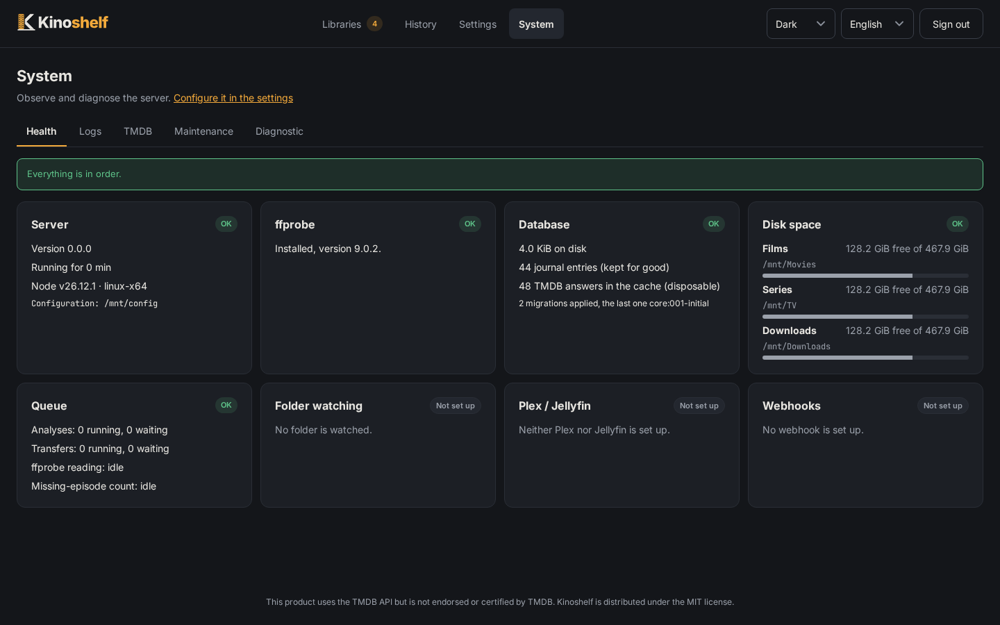
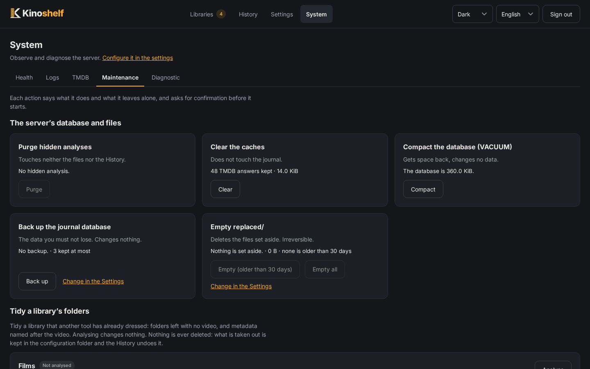

# System

The **System** page is where the server is _observed_; the [Settings](1-web-ui.md#settings) stay
where it is configured. It has five tabs: Health, Logs, TMDB, Maintenance and Diagnostic. The tab is
in the address (`/system`, `?tab=logs`, `?tab=tmdb`, `?tab=maintenance`, `?tab=diagnostic`).

## Health

Eight cards, each `ok`, `warn`, `danger` or `off` (nothing set up: neither good nor wrong), with a
cause for each problem and a link to the Settings section that fixes it:

| Card            | What it watches                                                              |
| --------------- | ---------------------------------------------------------------------------- |
| Server          | the server itself                                                            |
| ffprobe         | whether it is found and runs                                                 |
| Database        | readable, its size, the migrations applied                                   |
| Disk space      | free space under the libraries and the config folder (warns under 5 %)       |
| Queue           | jobs waiting, running or failed                                              |
| Folder watching | last and next pass, and the releases sent to the queue in the last 24 hours  |
| Plex / Jellyfin | reachable, signed in, the last library refreshes and the folders that failed |
| Webhooks        | the last deliveries and their attempts                                       |

The **System** entry of the header carries a red badge when there is an **error**: an unreadable
database, a library or watched folder that cannot be reached (an unmounted share), a Plex sign-in
that plex.tv refused. A **warning** (ffprobe missing, disk almost full, a failing webhook, a media
server refresh that failed) never turns the badge red.

## Logs

The server's log, in the page and in `<config>/logs/kinoshelf.log` (rotated at 10 MB, 3 files kept,
read back after a restart). Docker's own log (`docker logs`) shows the same lines.

- Each line has a **component** (`server`, `http`, `scan`, `transfer`, `watcher`, `tmdb`, `notify`,
  `collections`, `maintenance`) and sometimes a job.
- Filters: level, component, search text and period, all kept in the address, so a link opens the
  page already filtered.
- The view follows the log live. Opening a line pauses it, and the page then counts the newer lines.
- **Download** the log as a file.
- **Level**: `info` by default (or `KINOSHELF_LOG_LEVEL`). The page can raise it to `debug` at once,
  until the next restart: it is a way to find a problem, not a setting. A `debug` line exists only
  while the level records it.
- Secrets (the TMDB, API, Plex and Jellyfin keys, webhook addresses and headers) are wiped from every
  line when it is written, so the page, the file and the download are all clean.

## TMDB

TMDB reports no quota, so Kinoshelf counts its own calls: those answered by the cache and those sent
(retries included), by kind of call and outcome, with a median latency. Pick a period of 24 hours,
7 days or 30 days. The tab also lists the latest errors since the start (a 429, a 5xx, a network
failure or a refusal). Counts are kept for 30 days.

## Maintenance

### Tidy up a library

One block per library organized in place. **Analyse** is a dry run whose report stays until the next
one: folders to take out with their twin (an _approximate_ twin, found by title and year rather than
by name, is marked "To check"), folders left alone with the reason, images named after the video to
rename or set aside. **Tidy…** asks for confirmation (nothing is deleted, the History undoes it, and
another tool still managing the folder would write its files again), then runs the real task and
links its batches.

- A folder with no video goes only if it holds nothing but NFO, images and subtitles and a sibling
  holding a video bears the same name (case, accents, punctuation, an id tag, a quality suffix do not
  count). Each file is moved to `<config>/replaced/`, never deleted.
- In a movie library, metadata named after the video (`<video>-poster.jpg`, `-fanart`, `-clearlogo`)
  is renamed to Kinoshelf's names, or set aside when those exist. `<video>.nfo` is handled only when
  you tick **also handle `<film>.nfo`**, beside a `movie.nfo` and in a folder of a single video.
- The task runs in the background with a bar, and the page finds it again if you leave and come back.

The same tidy-up is available on the command line (`kinoshelf tidy`, see [Command line](7-cli.md)).

### Database and files

A grid of cards, each saying what it does and what it leaves alone, and asking before it starts:

- **Purge hidden analyses**: forgets at once the analyses the History hides, without waiting for the
  daily purge. Never one with a transfer, a failure, a file still waiting in Arrivals or a row a
  library's list reads.
- **Clear the caches**: empties the TMDB cache. The journal is untouched.
- **Back up the database**: a consistent copy to `<config>/backups/kinoshelf-YYYYMMDD-HHMM.sqlite`
  (UTC), then the oldest beyond the number to keep (Settings › Retention, 3) are removed.
- **Compact**: `VACUUM`. Refused while a scan or a transfer runs, since it holds the server for its
  duration.
- **Empty replaced/**: the one place Kinoshelf **deletes for good**. It removes the files set aside
  longer ago than the retention (30 days by default; or all of them), after counting the files, the
  bytes and the batches that could then no longer restore everything. It needs a ticked box and is
  refused while a scan, a transfer, an undo or a tidy-up runs. What is still there can still be
  restored by an undo; what is gone is skipped.

Database backup and compaction cannot run together.

## Diagnostic

For a bug report: **Download the diagnostic archive**, a zip holding the versions (Kinoshelf, Node,
system, ffprobe), the configuration without secrets (a secret is only said to be set), the health
report, 7 days of TMDB counts and the 2000 newest log lines. A preview of the configuration is shown
first. Read it before publishing: it holds your folder and file names. The page also links to the
GitHub issue form with the versions already in its body.

## Where files go

| Folder                        | What it holds                                                  |
| ----------------------------- | -------------------------------------------------------------- |
| `<config>/config.yaml`        | the settings (secrets included; readable by its owner only)    |
| `<config>/kinoshelf.sqlite`   | the journal, the library snapshot, jobs, and the TMDB cache    |
| `<config>/images/`            | posters served to the web, fetched once from TMDB              |
| `<config>/replaced/`          | files set aside by a replacement, a tidy-up or an image change |
| `<config>/collection-images/` | the images chosen for collections                              |
| `<config>/backups/`           | database backups                                               |
| `<config>/logs/`              | the server log                                                 |
